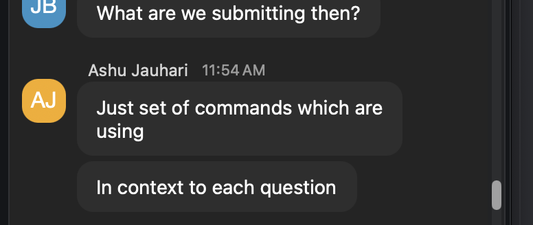
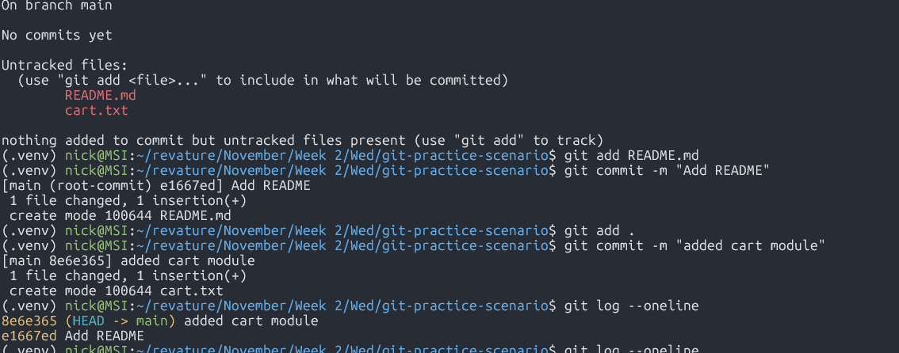
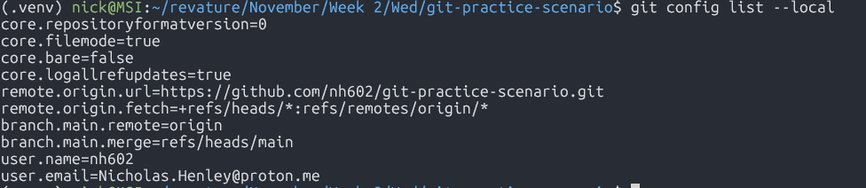
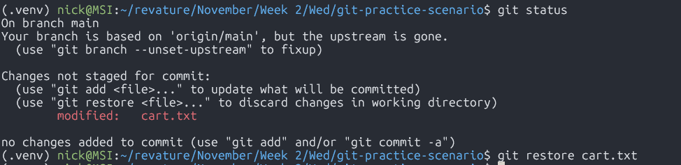
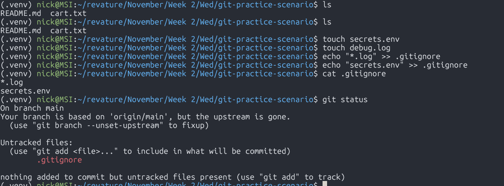
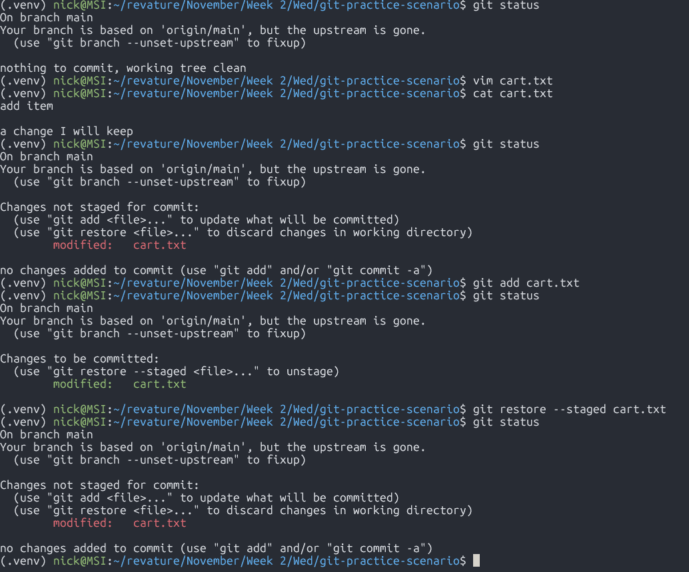
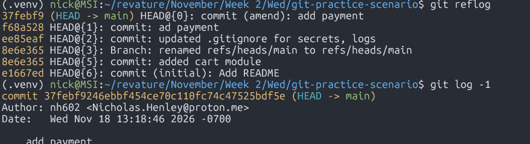
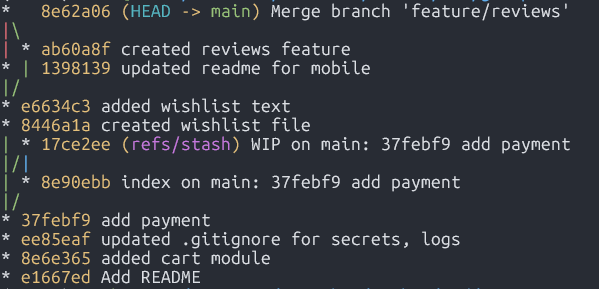
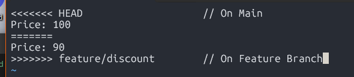
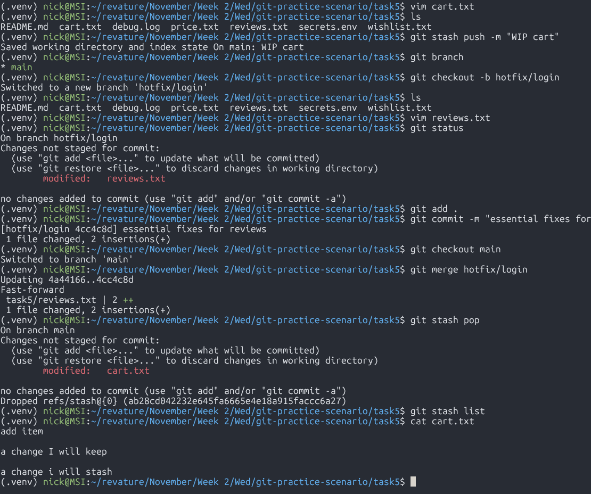

# Git Practice Scenario Submission

I created this repo for these steps. I wasn't sure exactly how to reconcile the instructions (which heavily modify the git history) with the other assignments in one big shared repo.

Instead, I think the pattern must be to 1) actually practice in one repo and then 2) submit my reflection / submission requirements in the shared assignment repo. 

URL: https://github.com/nh602/git-practice-scenario.git

It was confirmed that the directions are as follows in this screenshot. I'm going to follow this format in task 6 onward now that I understand better.




# Steps

## Git Init

### Task 1

I ran `git init` in my directory. I also ran `git remote add origin https://...` to add the github remote.

I then created the readme and cart files, and then committed them one by one.
Here's the output which shows all my commits and then the `git log --oneline` command.



#### Guidance

1. Config can apply to one repo, to your user, or to the whole machine. Which option limits a setting to this repo? Check by listing the config afterwards. 

`git config --local` is the default when running the config command and keeps the change local to the repo. 



2. Staging and committing are separate steps. What does git status show for a file that is untracked, versus one that is staged? 

One that is untracked is red and in the bottom section called Untracked. One that is staged is green and above the untracked files.

### Task 2

Next I made an edit to the cart.txt file in vim and then discarded the change with `git restore cart.txt`.



Then i created the `secrets.env` and `debug.log` files; added the two lines to the gitignore with `echo >> .gitignore` and then showed the `git status` which doesn't show the two files as Untracked (meaning gitignore is working).



Next I made an edit in vim to the cart.txt file, staged it with `git add cart.txt`, and then unstaged the change with `git restore --staged cart.txt`. You can see that since it's still in the not Staged section that the file changes remained. 



Next I added the cart.txt file again, and committed with the message  `ad payment`. then I used `git commit --amend` to edit the message to `add payment` which you can see below.




#### Guidance

1. Amending rewrites the last commit. Ask yourself: is that still safe once the commit has been shared? 

No. Once shared, the change has been distributed. You can ammend but it will still have been shared to remote machines and put in the git history. 

### Task 3

I created the branch using `git checkout -b feature/wishlist` to create and checkout in one command. Then I created a file, committed, and then added text to the file, committed again. Those steps created my required 2 commits. I merged after checking out main with `git merge feature/wishlist`.

Ran `git checkout main` and then `git checkout -b feature/reviews` so that the base of my branch is from main (not the feature/wishlist branch).

I created a file `reviews.txt` and commited it on the feature/reviews branch. Then I switched back to main and added a line to the readme and committed so that the branches diverge. 

I was able to run `git merge feature/reviews` from main, which brought up nano for a commit message. I deleted the feature branches after this with `git branch -d <branch>`.

Here's my `git log --oneline --graph --all` so far for verification on this step.



#### Guidance
1. A fast-forward is possible only when main is an ancestor of the branch you merge. Check with the graph log before you merge and predict the outcome. 

My log showed that fast forward was not possible since the branches diverged. I had a stash you can ignore, but you can see the divergence. 

2. To make two branches diverge, what must be true of the new commit on each? 

The main branch has to have a commit placed after you ran the `git branch` command.

3. You merge into the branch you are standing on. Which branch must be checked out first? 

If you're merging into main, you switch from your feature branch to main and then merge.

4. Branch deletion has a safe form that refuses to remove unmerged work. Prefer it, and note when it complains. 

Running `git branch -d <branch name>` with unmerged commits prompts you to try `git branch -D <branch name>` to force it.

### Task 4

In task 4 I created price.txt and added the `Price: 100` line and commited. 

Then I created the new branch and changed the price to 90, then commited on `feature/discount`. I did not merge.

Switching back to main, I changed price to 110 and commited. 

Now I'll try to merge.

```
Auto-merging task4/price.txt
CONFLICT (content): Merge conflict in task4/price.txt
Automatic merge failed; fix conflicts and then commit the result
```

I aborted the merge with `git merge --abort`.

Now I'll try merge again, but I'll resolve the conflict by editing the file after. I simply removed all the lines in the file and replaced it with `Price: 95` since it's such as simple conflict. 

#### Guidance

1. Open the conflicted file and identify the three parts: your side, the incoming side, and the separator lines between them. 

Heres an annotated picture of that file that shows the parts



2. During a merge, git status lists the file as modified on both sides. After you edit it, what must you tell Git so it knows the conflict is resolved? 

You must add and then commit the change.

### Task 5

First I made an edit to cart.txt adding a line about the stash.

Then I used `git stash push -m "WIP cart"` to stash the change. I was already on main, so then I ran `git checkout -b hotfix/login`.

On the hotfix branch I made an edit to reviews, commited, switched back to main, and then merged.

Finally I ran `git stash pop` to get my most recent stash applied to main so i can continue working.

In this image you can see my stash, my changes, my merge, and then my apply and showing the stash is empty after.


### Task 6

Here are the commit commands I ran to create my four commits. I created an empty file for each one.

* git commit -m "A"
* git commit -m "B"
* git commit -m "C"
* git commit -m "D"

I use `git reflog` to find the pointer to commit C.

Then I ran `git revert c668e86` to revert commit C, which prompted me with nano for a commit message.

It makes sense that we retain the history because someone later may need to understand the decision made and why it was reverted - the history proves we tried something and maybe it didn't work or similar situation.

Create commit E

* git commit -m "E"

Next I ran this command to reset the HEAD pointer to before E. We're on the previous commit that reverted C, though we can still see the detached commit E in the reflog.

```
fb91d54 (HEAD -> main) HEAD@{0}: reset: moving to HEAD~1
98d296f HEAD@{1}: commit: E
fb91d54 (HEAD -> main) HEAD@{2}: revert: Revert "C"
```

* git reset --soft HEAD~1

I'll now run `git reset --hard HEAD~2`.

I was able to return to another commit first by looking up the pointer using `git reflog` and then by using `git checkout <pointer>`. I confirmed with `git log` that the commit returned. I could merge that, check it out in another branch, etc to recover it fully instead of a detached head state.

`git reset --hard ORIG_HEAD` is what I'll run to get to a clean state for the next task.

### Task 7

Checkout new branch
* git checkout -b feature/checkout

I'll create files and commit like this for my messy commits. 
* git commit -m "messy1"
* git commit -m "messy2"
* git commit -m "messy3"
* git commit -m "messy4"

Add commit to main
* git checkout main
* git commit -m "messy main"

Now I'll switch to the other branch to rebase
* git checkout feature/checkout
* git rebase -i main

The git log graph shows a single line through the messy commits via `git log --oneline --graph`

### Task 8

Start on main and create a file with a bug to fix.

* `echo 'Checkout validation: broken' > task8/checkout.txt`
* `git add task8/checkout.txt`
* `git commit -m "Add checkout bug scenario"`

Create three commits on dev, with only the second fixing the bug.

* `git checkout -b dev`
* `echo 'Development notes' > task8/dev-notes.txt`
* `git add task8/dev-notes.txt`
* `git commit -m "Add development notes"`
* `echo 'Checkout validation: fixed' > task8/checkout.txt`
* `git add task8/checkout.txt`
* `git commit -m "Fix checkout validation"`
* `echo 'Experimental feature' > task8/experiment.txt`
* `git add task8/experiment.txt`
* `git commit -m "Add experimental feature"`
* `git log --oneline -3`

Cherry-pick the second dev commit onto main and create the annotated tag.

* `git checkout main`
* `git cherry-pick dev~1`
* `git tag -a v1.0.0 -m "Release v1.0.0"`
* `git show v1.0.0`

Change the file, compare it with the tag, then discard that practice change before Task 9.

* `echo 'Release follow-up' >> task8/checkout.txt`
* `git diff v1.0.0`
* `git tag`
* `git log --oneline -3`
* `git restore task8/checkout.txt`

### Task 9

Keep the existing GitHub remote as github and use the local bare repo as origin.

* `git init --bare --initial-branch=main ~/server.git`
* `git remote rename origin github`
* `git remote add origin ~/server.git`
* `git push -u origin main`

Clone the server and push a teammate's change.

* `git clone ~/server.git ~/teammate`
* `cd ~/teammate`
* `echo 'Teammate contribution' > teammate.txt`
* `git add teammate.txt`
* `git commit -m "Add teammate contribution"`
* `git push`

Return to the practice repo, fetch to compare, then pull the change.

* `cd ~/revature/November/Week\ 2/Wed/git-practice-scenario`
* `git fetch origin`
* `git diff main origin/main`
* `git pull --ff-only`

Push a new branch, delete it from the remote, and verify the result.

* `git checkout -b collaboration-demo`
* `git push -u origin collaboration-demo`
* `git checkout main`
* `git push origin --delete collaboration-demo`
* `git branch -r`
* `git status`

### Task 10

Create the payment file on main so both branches can change the same line.

* `git checkout main`
* `mkdir -p task10`
* `echo 'Payment validation: missing' > task10/payments.txt`
* `git add task10/payments.txt`
* `git commit -m "Add payment scenario"`

Create two feature commits, then stash some unfinished work.

* `git checkout -b feature/payments`
* `printf 'Payment validation: missing\nPayment provider: demo\n' > task10/payments.txt`
* `git add task10/payments.txt`
* `git commit -m "Add payment provider"`
* `echo 'Receipt enabled' > task10/receipt.txt`
* `git add task10/receipt.txt`
* `git commit -m "Add payment receipts"`
* `echo 'Payment notes in progress' > task10/notes.txt`
* `git stash push -u -m "WIP payments"`

Fix the bug on a hotfix branch, merge it into main, and tag the release.

* `git checkout main`
* `git checkout -b hotfix/payment-validation`
* `echo 'Payment validation: required' > task10/payments.txt`
* `git add task10/payments.txt`
* `git commit -m "Fix critical payment validation bug"`
* `git checkout main`
* `git merge --no-ff hotfix/payment-validation -m "Merge payment validation hotfix"`
* `git tag -a v1.0.1 -m "Release v1.0.1"`

Restore and commit the unfinished feature work, then rebase onto main.

* `git checkout feature/payments`
* `git stash pop`
* `git add task10/notes.txt`
* `git commit -m "Add payment notes"`
* `git rebase main`

Resolve the conflict by keeping the validation fix and payment provider, then save and close any commit-message editor.

* `git status`
* `printf 'Payment validation: required\nPayment provider: demo\n' > task10/payments.txt`
* `git add task10/payments.txt`
* `git rebase --continue`

In the interactive editor, keep the first pick and change the remaining picks to fixup, then save and close.

* `git rebase -i main`
* `git log --oneline main..feature/payments`

Merge the squashed feature with a merge commit and push main and the tags to the local server.

* `git checkout main`
* `git merge --no-ff feature/payments -m "Merge payments feature"`
* `git push origin main --tags`

Revert that merge using its first parent as mainline and push the recovery.

* `git revert -m 1 --no-edit HEAD`
* `git push origin main`
* `git status`
* `git log --oneline --graph --decorate -10`
* `git ls-remote --tags origin`
* `git diff v1.0.1 main`
