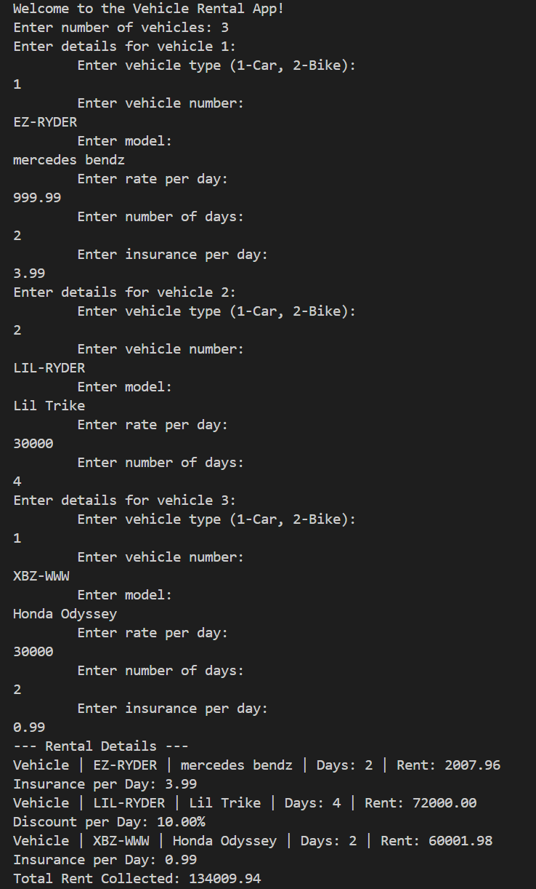

# Vehicle Rental Lab

Using polymorphism in the Car and Bike classes which extend the functionality of the Vehicle class. The vehicle class has some common methods for related business logic, and the `display` and `calculateRent` methods are overrided in each class for their specific implementations. In this way we can operate on all the vehicles using shared interfaces despite their differing internal implementations.

We use super() in the constructors and in the display function.

# Examples

